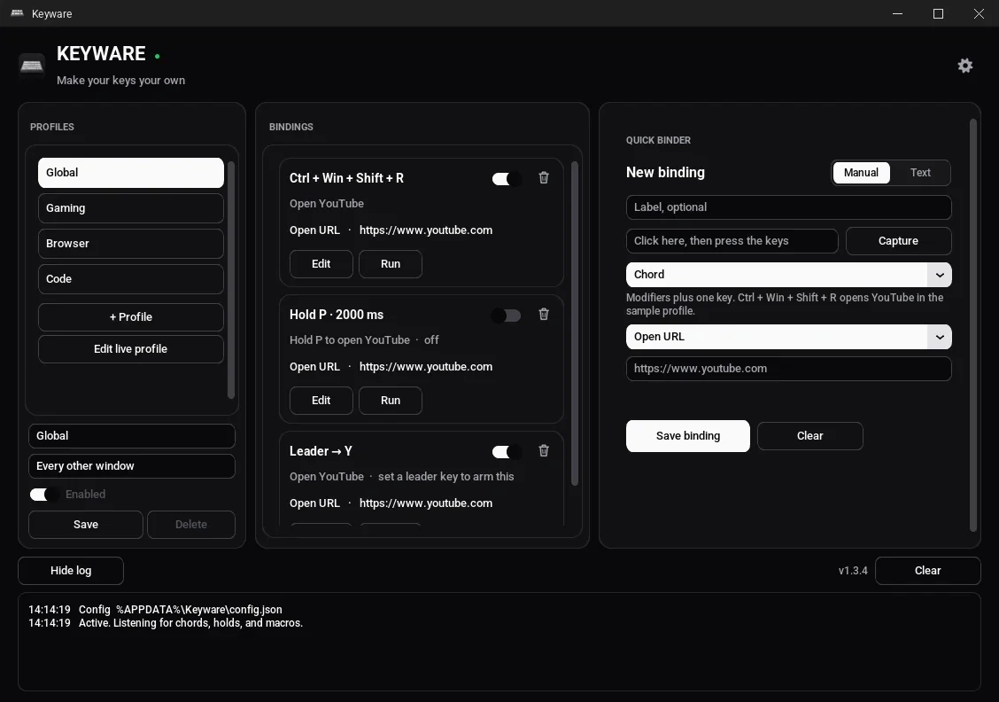
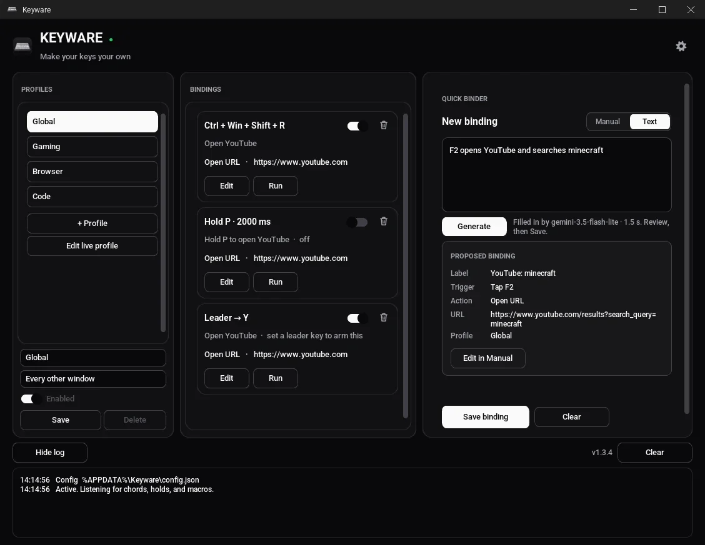
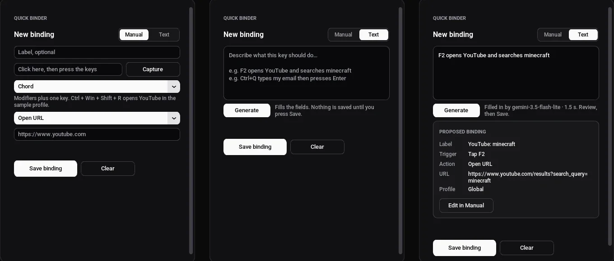
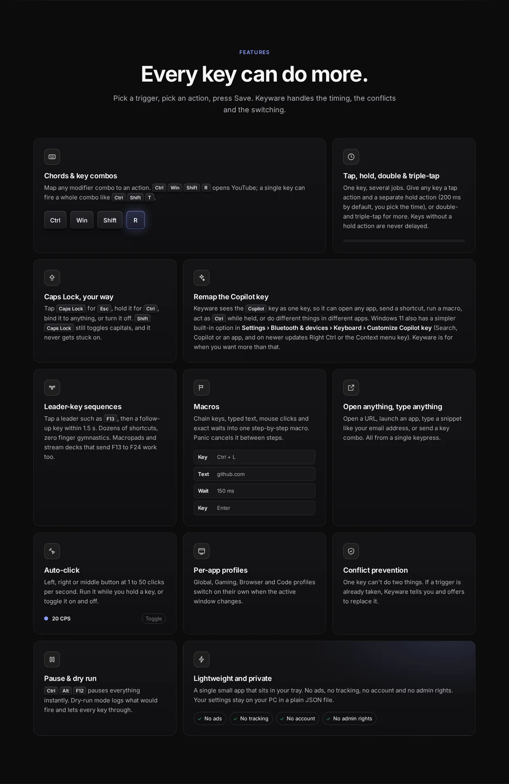
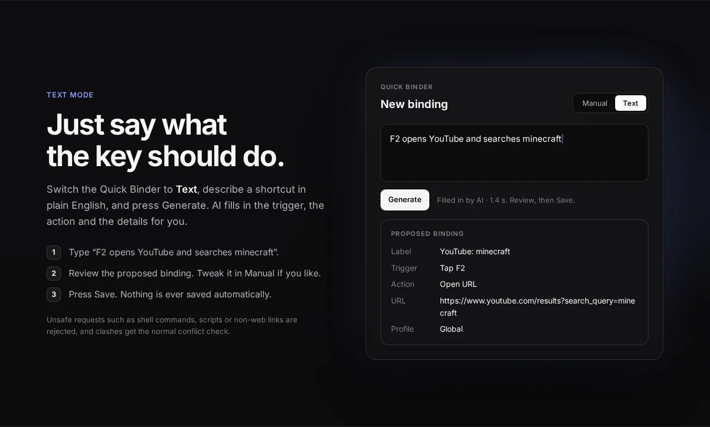
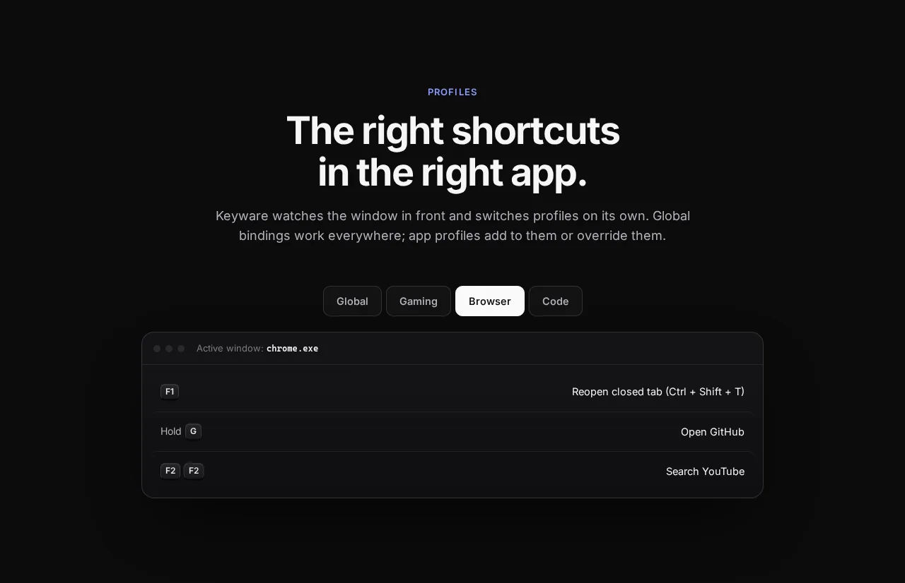
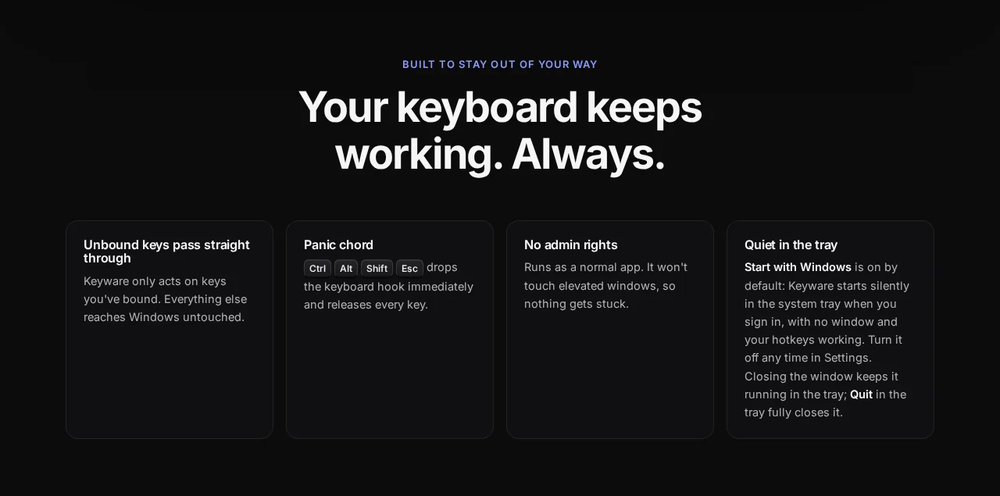
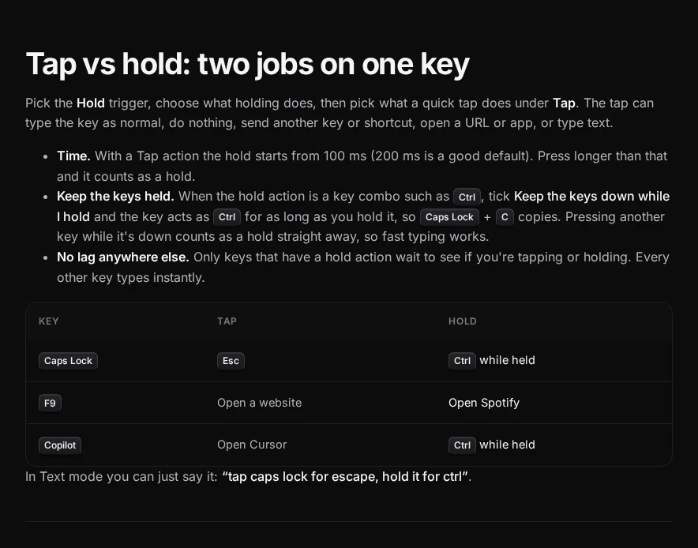
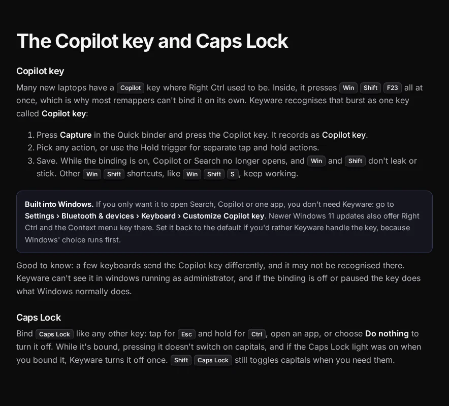

<p align="center">
  
</p>

<h1 align="center">Keyware</h1>

<p align="center"><strong>Make your keys your own.</strong></p>

<p align="center">
  Remap any key or mouse button, build macros and hotkeys, and set per-app shortcuts, just by describing them in plain English.<br>
  <a href="https://keyware.site/#install">Download for Windows</a> ·
  <a href="https://keyware.site/guide">Guide</a> ·
  <a href="https://keyware.site/whats-new">What's new</a> ·
  <a href="https://keyware.site/privacy">Privacy</a> ·
  <a href="https://ko-fi.com/keyware_donate">Donate</a> ·
  <a href="LICENSE">MIT License</a>
</p>

---

## What it is

Keyware maps keys, chords, holds, double-taps and leader sequences to actions:
open a website or app, type text, send a key combo, control media, play a song,
auto-click, or run a whole macro. Bindings can change with the app in front
(Global, Gaming, Browser, Code profiles).

You can build a binding by hand, or just **describe it**: type
*"F9 opens YouTube and F10 locks my PC"* and Keyware turns the sentence into
bindings you review before saving. Nothing is ever saved automatically.

- **Safe by design.** An unbound key is never swallowed, the hook only runs while
  Keyware is ON, and **Ctrl + Alt + Shift + Esc** drops it instantly.
- **No admin rights, no ads.**
- **Starts with Windows by default**, silently in the system tray (no window, hotkeys working). Turn it off in Settings. Closing the window keeps Keyware in the tray; **Quit** in the tray fully closes it.
- **The hook engine never touches the network.** Optional Text mode sends the
  sentence you type and a short setup summary (not your keystrokes). Optional
  feedback from Settings, and actions you create that look something up (such as
  a *Play* song or video), also use the network. What each one sends is on the
  [privacy page](https://keyware.site/privacy).

## New in 1.4.1

- **Scripts, if you want them.** Settings has **Advanced scripting**, off by default.
  Manual and Text mode stay the same. Turn it on and a binding can carry a short
  script: branch on the app, profile, setup, or held modifiers, then type, click,
  open something, or run the normal action with `do`. A script cannot open a
  shell or run a command, and it cannot wait more than 2 seconds in total.
  The keyboard hook never runs it. Pause and **Ctrl + Alt + Shift + Esc** stop
  it between steps and release any key it was holding.
- **Quieter hook path.** Keyware checks the config file at most twice a second,
  writes log lines off the hook thread, and remembers which mouse buttons are
  bound instead of scanning every binding on each click.

## New in 1.4.0

- **Store apps open.** Phone Link and other Microsoft Store apps have no normal
  exe. Keyware opens them from the Start menu name (an app id such as
  `Microsoft.YourPhone_8wekyb3d8bbwe!App`), a shortcut, App Paths, or PATH.
  A missing path is reported and not launched.
- **Text mode knows those names.** Phone Link, Settings, Calculator, Edge,
  Chrome, VS Code, Spotify, WhatsApp, Discord, and Teams are matched to what
  is installed. The check stays on your PC.
- **Tab works in a shortcut**, as the key you press and as the key Keyware sends.
- **More keys:** Scroll Lock, Page Up, Page Down, Home, End, Delete, Insert,
  Print Screen, and Pause/Break. The editor has a picker for them.
- **Update check.** Once a day Keyware asks GitHub which release is current
  (`notomar2014-ui/keyware`). A small banner can open the Microsoft Store
  (product `9NGDP5BL0105`) or [keyware.site](https://keyware.site/#install).
  Nothing is downloaded. Later and Skip this version hide it. Settings can
  turn the check off. Offline stays quiet.

## New in 1.3.9

- **Text mode is a normal sentence.** The box asks what the key should do and
  shows examples. There is no format to learn.
- **Every window unless you name an app.** “F7 opens Calculator” opens the
  Calculator app everywhere. Say “in Chrome” or “while gaming” to limit it.
  The proposed card says where it will work.
- An older binding saved as `open_calculator` opens `calc.exe`. Other bindings
  and profiles stay as they are.

## New in 1.3.8

- **Per-app rules no longer stick a key.** For App or Both, the physical
  key-down and key-up both reach the app. App skips Keyware's action and the
  hold beep. Both runs the action and still passes the key. A short hold does
  not type that key a second time.

1.3.7 added setups inside a profile, an on/off shortcut with toasts, and
per-app shortcut rules. 1.3.6 added binding any key or mouse button and a
Donate button. See the full list at
[keyware.site/whats-new](https://keyware.site/whats-new).

## Screenshots

<p align="center">
  
  <br><sub>The Keyware app: your key bindings at a glance</sub>
</p>

<table>
<tr>
<td width="50%" align="center"><br><sub>Text mode: describe a binding in plain words</sub></td>
<td width="50%" align="center"><br><sub>Manual and Text modes</sub></td>
</tr>
<tr>
<td width="50%" align="center"><br><sub>Features at a glance</sub></td>
<td width="50%" align="center"><br><sub>AI Text mode</sub></td>
</tr>
<tr>
<td width="50%" align="center"><br><sub>Per-app profiles</sub></td>
<td width="50%" align="center"><br><sub>Safe by design: always works</sub></td>
</tr>
<tr>
<td width="50%" align="center"><br><sub>Guide: tap vs. hold</sub></td>
<td width="50%" align="center"><br><sub>Guide: remap Copilot / Caps Lock</sub></td>
</tr>
</table>

## Download

The site offers two Windows builds, each with its own size and SHA-256:
64-bit `Keyware.exe` and native ARM64 `Keyware-arm64.exe`.
Get them from **https://keyware.site/#install**.
The [guide](https://keyware.site/guide)
walks through the first setup. Windows 10 or 11. Most PCs use the 64-bit
file, which also runs under emulation on ARM64 Windows. Windows on ARM,
including Copilot+ PCs, uses the ARM64 file. PyInstaller cannot cross-compile,
so that file is built on GitHub's `windows-11-arm` runner.

There is no Mac download. Remapping is the Windows hook described below.
A Mac build of this code would not remap keys.

## Build from source

You need Windows and Python 3.11 or newer. Remapping is a Windows low-level hook (`WH_KEYBOARD_LL` / `WH_MOUSE_LL`) plus `SendInput`. On macOS or Linux the window can edit bindings, and `python main.py --self-test` checks the engine, but turning Keyware on does not install a hook. A Mac build would need a different input stack. Details are in [docs/TECHNICAL.md](docs/TECHNICAL.md).

```bat
git clone https://github.com/notomar2014-ui/keyware.git
cd keyware
py -3 -m venv .venv
.venv\Scripts\python.exe -m pip install -r requirements-dev.txt

:: run it
.venv\Scripts\pythonw.exe keyware.pyw

:: run the tests (no real hook, no keystrokes, no apps opened)
.venv\Scripts\python.exe -m pytest

:: build dist\Keyware.exe (PyInstaller, Windows only)
.venv\Scripts\python.exe build.py
```

`run.bat` creates the virtual environment and starts Keyware in one step.
`python main.py --self-test` checks the engine without installing a hook.

Every push is tested and built by GitHub Actions
([`.github/workflows/build.yml`](.github/workflows/build.yml)).
`windows-latest` produces the unsigned x64 exe. `windows-11-arm` produces the
unsigned native ARM64 exe. Each run uploads both artifacts. A push to `main`
attaches `Keyware-arm64.exe` to the existing GitHub release when that asset
is not already there, and writes that file's SHA-256 into the release notes.
It does not replace the published x64 `Keyware.exe`.

### Text mode and API keys

By default Text mode goes through the Keyware proxy (the code is in [`site/api`](site/api)),
which holds the provider keys and applies a small daily limit per install.
In Settings you can **use your own free key** (Gemini or Groq) instead; it is
stored with Windows DPAPI and never logged. The app never reads a `.env` file and
the repository contains no keys. Developers running from source can set
`KEYWARE_DEV_KEYS=1` with `GEMINI_API_KEY` / `GROQ_API_KEY` in their environment.

## Repository layout

```text
main.py, keyware.pyw   entry points
engine/                hook, detector, actions, config (no network)
assist/                Text mode (AI binder), feedback, DPAPI key store
ui/                    CustomTkinter window, tray, assets
tests/                 headless pytest suite
tools/                 dev helpers (live AI check, end-to-end driver, previews)
build.py, keyware.spec PyInstaller one-file build
site/                  the website and its serverless API (Vercel)
docs/TECHNICAL.md      safety model, config file, sample bindings
```

## Privacy

Keyware keeps your bindings on your PC. What the optional Text mode, feedback form
and download counter send is listed on the
[privacy page](https://keyware.site/privacy).

## Contributing and security

Issues and pull requests are welcome; see [CONTRIBUTING.md](CONTRIBUTING.md).
Please report vulnerabilities privately as described in [SECURITY.md](SECURITY.md).

## Support Keyware

Keyware is free and has no ads. If it saves you time, you can support it on Ko-fi:
[Support Keyware on Ko-fi](https://ko-fi.com/keyware_donate)

## License

[MIT](LICENSE) © 2026 Keyware contributors.
Windows is a trademark of Microsoft.
