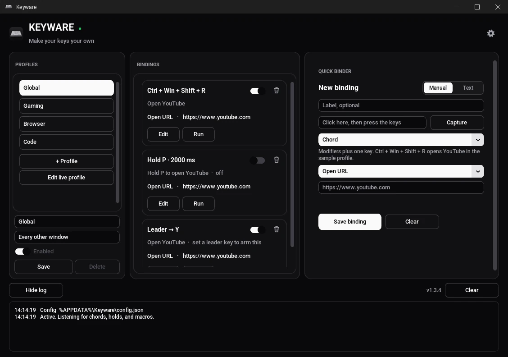
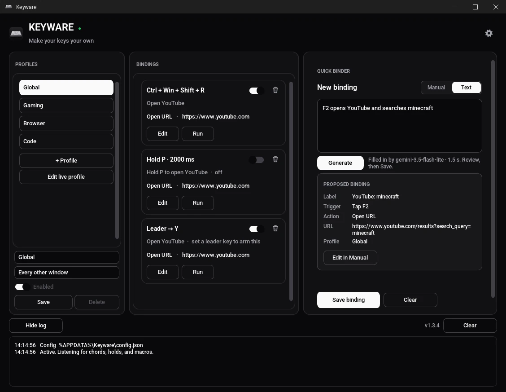
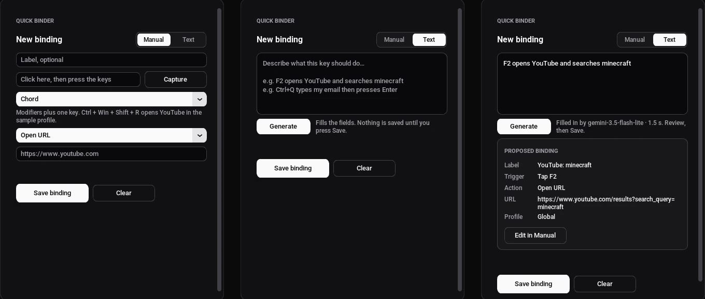

<p align="center">
  
</p>

<h1 align="center">Keyware</h1>

<p align="center"><strong>Make your keys your own.</strong></p>

<p align="center">
  A free Windows key remapper and macro engine with plain-English AI bindings.<br>
  <a href="https://keyware-app.vercel.app/download">Download for Windows</a> ·
  <a href="https://keyware-app.vercel.app/guide">Guide</a> ·
  <a href="https://keyware-app.vercel.app/privacy">Privacy</a> ·
  <a href="LICENSE">MIT License</a>
</p>

---

## What it is

Keyware maps keys, chords, holds, double-taps and leader sequences to actions:
open a website or app, type text, send a key combo, control media, play a song,
auto-click, or run a whole macro. Bindings can change with the app in front
(Global, Gaming, Browser, Code profiles).

You can build a binding by hand, or just **describe it**: type
*"F9 opens YouTube and F10 locks my PC"* and Keyware turns the sentence into
bindings you review before saving. Nothing is ever saved automatically.

- **Safe by design.** An unbound key is never swallowed, the hook only runs while
  Keyware is ON, and **Ctrl + Alt + Shift + Esc** drops it instantly.
- **No admin rights, no startup entry, no ads.**
- **The hook engine never touches the network.** The only web requests are the
  optional Text-mode AI call and the song/video lookup a *Play* action makes.

## Screenshots

| Bindings | Describe it (Text mode) | Manual / Text |
| --- | --- | --- |
|  |  |  |

## Download

Get the latest `Keyware.exe` from **https://keyware-app.vercel.app/download**.
The [guide](https://keyware-app.vercel.app/guide)
walks through the first setup. Windows 10 or 11.

## Build from source

You need Windows and Python 3.11 or newer.

```bat
git clone https://github.com/notomar2014-ui/keyware.git
cd keyware
py -3 -m venv .venv
.venv\Scripts\python.exe -m pip install -r requirements-dev.txt

:: run it
.venv\Scripts\pythonw.exe keyware.pyw

:: run the tests (no real hook, no keystrokes, no apps opened)
.venv\Scripts\python.exe -m pytest

:: build dist\Keyware.exe (PyInstaller, Windows only)
.venv\Scripts\python.exe build.py
```

`run.bat` creates the virtual environment and starts Keyware in one step.
`python main.py --self-test` checks the engine without installing a hook.

Every push is tested and built on `windows-latest` by GitHub Actions
([`.github/workflows/build.yml`](.github/workflows/build.yml)); the unsigned exe is
attached to each run as an artifact.

### Text mode and API keys

By default Text mode goes through the Keyware proxy (the code is in [`site/api`](site/api)),
which holds the provider keys and applies a small daily limit per install.
In Settings you can **use your own free key** (Gemini or Groq) instead; it is
stored with Windows DPAPI and never logged. The app never reads a `.env` file and
the repository contains no keys. Developers running from source can set
`KEYWARE_DEV_KEYS=1` with `GEMINI_API_KEY` / `GROQ_API_KEY` in their environment.

## Repository layout

```text
main.py, keyware.pyw   entry points
engine/                hook, detector, actions, config (no network)
assist/                Text mode (AI binder), feedback, DPAPI key store
ui/                    CustomTkinter window, tray, assets
tests/                 headless pytest suite
tools/                 dev helpers (live AI check, end-to-end driver, previews)
build.py, keyware.spec PyInstaller one-file build
site/                  the website and its serverless API (Vercel)
docs/TECHNICAL.md      safety model, config file, sample bindings
```

## Privacy

Keyware keeps your bindings on your PC. What the optional Text mode, feedback form
and download counter send is listed on the
[privacy page](https://keyware-app.vercel.app/privacy).

## Contributing and security

Issues and pull requests are welcome; see [CONTRIBUTING.md](CONTRIBUTING.md).
Please report vulnerabilities privately as described in [SECURITY.md](SECURITY.md).

## Support Keyware

Keyware is free and has no ads. If it saves you time, you can support it on Ko-fi:
[Support Keyware on Ko-fi](https://ko-fi.com/keyware)

## License

[MIT](LICENSE) © 2026 Keyware contributors.
Windows is a trademark of Microsoft.
